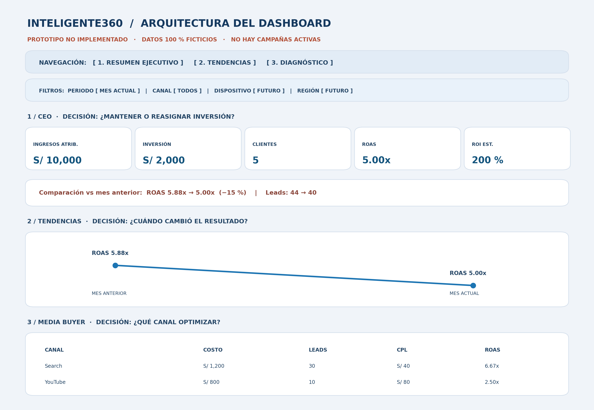

# Dashboard de performance — Inteligente360

> **CASO ACADÉMICO. DATOS 100 % SIMULADOS.** No existen campañas activas de Inteligente360 para este trabajo. No se ha conectado Google Ads, GA4, CRM ni Looker Studio. Las cifras son ejemplos para explicar decisiones y cálculos.

## Objetivo de negocio y alcance

Inteligente360 comercializa un ERP para empresas. El recorrido supuesto es **anuncio → solicitud de demostración (lead) → demo → contratación → ingresos**. Se plantea un tablero de análisis de campañas hipotéticas de **Google Search y YouTube Ads**. Un lead **no equivale a una venta**. El proyecto es una **arquitectura y prototipo**, no un dashboard operativo.

## 1. Arquitectura del dashboard y decisiones

| Capa / vista | Quién la usa | Qué muestra | Qué decisión habilita |
|---|---|---|---|
| **1. Resumen ejecutivo** | **CEO / gerencia** | Ingresos atribuidos, inversión, contrataciones, ROAS, ROI estimado y comparación contra periodo anterior. | Mantener, aumentar o reconsiderar presupuesto en función del retorno y las contrataciones. |
| **2. Tendencias** | CEO y responsable de marketing | Evolución del ROAS, inversión, ingresos y leads, con comparación mes actual vs anterior. | Detectar cuándo cayó la rentabilidad y priorizar una investigación. |
| **3. Diagnóstico** | **Media Buyer** | Campañas Search y YouTube; impresiones, clics, CTR, CPC, CPL, leads, demos, clientes y ROAS. | Ajustar campañas, anuncios, segmentación y distribución de inversión. |

**Separación explícita de roles:** el CEO ve primero resultados económicos; el Media Buyer accede después a señales operativas para explicar esos resultados. Las visualizaciones de YouTube no sustituyen métricas de ingresos o contrataciones.

## 2. Jerarquía visual y navegación



**Orden de lectura:** (a) aviso de simulación, navegación y filtros; (b) cinco tarjetas ejecutivas; (c) variación respecto al mes anterior; (d) tendencia del ROAS; (e) tabla diagnóstica por canal. El wireframe es un **boceto visual**, no una captura de Looker Studio.

**Filtros:** periodo, campaña/canal, dispositivo y región. Los dos últimos se proponen para una futura conexión: **no hay cifras simuladas desagregadas por dispositivo o región** y por eso no se muestran resultados inventados para esos cortes.

## 3. Datos y supuestos explícitos

| Canal | Inversión | Leads | Demos | Clientes | Ingresos atribuidos |
|---|---:|---:|---:|---:|---:|
| Search | S/ 1,200 | 30 | 15 | 4 | S/ 8,000 |
| YouTube | S/ 800 | 10 | 5 | 1 | S/ 2,000 |
| **Total** | **S/ 2,000** | **40** | **20** | **5** | **S/ 10,000** |

Los ingresos atribuidos son **ficticios** y se consideran generados en el mismo periodo evaluado que el gasto publicitario. Se asume que la atribución comercial ya está conciliada, únicamente para poder practicar el cálculo. No son ingresos por lead ni se ha comprobado una venta real.

**Margen de contribución supuesto: 60 %.** Ejemplo: por cada S/ 100 de ingresos, S/ 40 se destinan a costos variables del servicio y S/ 60 quedan de contribución antes de publicidad. No es un margen medido en Inteligente360; tampoco contempla todos los gastos fijos, impuestos o costos de adquisición no publicitarios.

## 4. ROAS / ROI y fórmulas listas para adaptar a Looker Studio

**ROAS = ingresos atribuidos / inversión = 10,000 / 2,000 = 5.00x.**

**ROI estimado = [(ingresos × margen de contribución) − inversión] / inversión = [(10,000 × 0.60) − 2,000] / 2,000 = 2.00 = 200 %.**

Campos necesarios en **una fuente unificada al mismo nivel de granularidad**: `Ingresos_Atribuidos` (moneda PEN, procedente conceptualmente de CRM), `Costo_Publicitario` (PEN, Ads), `Leads`, `Clics`, `Impresiones`, `Campana`, `Periodo`. `Ingresos_Atribuidos` **no es un campo nativo garantizado de Google Ads**. Hay que construirlo y conciliarlo con ventas; sin ese dato no puede calcularse ROAS de ingresos reales.

**Fórmulas de campos calculados** (agregaciones y protección ante costo cero):

```text
ROAS
CASE
  WHEN SUM(Costo_Publicitario) = 0 THEN NULL
  ELSE SUM(Ingresos_Atribuidos) / SUM(Costo_Publicitario)
END

ROI_Estimado
CASE
  WHEN SUM(Costo_Publicitario) = 0 THEN NULL
  ELSE ((SUM(Ingresos_Atribuidos) * 0.60) - SUM(Costo_Publicitario)) / SUM(Costo_Publicitario)
END

CPL
CASE WHEN SUM(Leads) = 0 THEN NULL
ELSE SUM(Costo_Publicitario) / SUM(Leads) END

CTR
CASE WHEN SUM(Impresiones) = 0 THEN NULL
ELSE SUM(Clics) / SUM(Impresiones) END
```

**Formato:** ROAS como número con sufijo `x`; ROI y CTR como porcentajes (sin multiplicar por 100 dentro de la fórmula); CPL en soles. Si se usa una combinación de datos (*blend*), primero debe evitarse duplicar costos o ingresos por cruces muchos-a-muchos. En Looker Studio, algunas combinaciones o fuentes pueden requerir calcular los totales en la fuente antes de crear el indicador. El Excel adjunto permite auditar las cifras y supuestos.

## 5. Storytelling: caída hipotética del 15 % en ROAS

> “En el escenario ficticio, el ROAS bajó de **5.88x** a **5.00x** (aproximadamente **−15 %**), aunque la inversión se mantuvo en **S/ 2,000**. Los ingresos atribuidos pasaron de **S/ 11,764.71** a **S/ 10,000**. No concluiría automáticamente que los anuncios empeoraron: revisaría si cambió la calidad de los leads, la tasa de cierre, el ingreso por cliente o la atribución. Después compararía Search y YouTube y, cuando haya datos, dispositivo y región. Recomendaría optimizar primero el canal con menor rentabilidad y verificar el efecto en contrataciones, no solo en clics.”

## 6. Fuentes previstas y limitaciones

- **Google Ads:** costo, impresiones, clics y campañas.
- **GA4:** eventos del sitio, especialmente `generate_lead`, si se implementa medición.
- **CRM / facturación:** demostraciones, contrataciones e ingresos atribuibles.
- **Looker Studio:** visualización del conjunto de datos reconciliado.

**Límite:** los archivos de este repositorio son datos de práctica. No se han conectado fuentes ni se han medido resultados de negocio reales.

## 7. Archivos para evaluación

- [`datos/Resultados_Simulados_Inteligente360.xlsx`](datos/Resultados_Simulados_Inteligente360.xlsx): tablas, cálculos y supuestos.
- [`diseno/Wireframe_Dashboard_Inteligente360.png`](diseno/Wireframe_Dashboard_Inteligente360.png): arquitectura visual y navegación.
- [`documentacion/Informe_Final_Dashboard_Inteligente360.pdf`](documentacion/Informe_Final_Dashboard_Inteligente360.pdf): explicación ampliada de cada criterio.

**Criterios atendidos:** arquitectura de tres capas y roles; fórmulas y margen justificados; jerarquía visual y navegación; filtros; storytelling con variación de ROAS.
